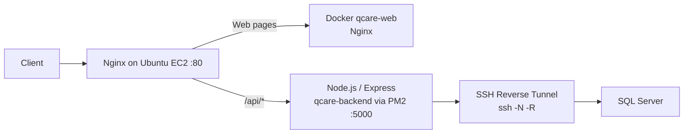

# Q Care

## 1. Overview

Q Care is a web application for booking at-home pet care services. It supports two main workflows: customers manage their pets and appointments, while administrators manage services and appointments.

**Live Demo:** [http://3.27.5.154](http://3.27.5.154)

## 2. Key Features

### Customers

- Browse service categories, details, and prices.
- Register, sign in, and change passwords.
- Add and view their pets.
- Select a date and time slot to book an at-home service.
- View and cancel their appointments.

### Admin

- View appointments and related customer information.
- Create, update, or deactivate services.
- Cancel appointments with a reason.
- Access protected admin APIs using JWT authentication and role checks.

## 3. Core Technologies

- **Frontend:** React, TypeScript, Vite
- **Backend:** Node.js, Express, JWT
- **Database:** Microsoft SQL Server
- **Deployment:** AWS EC2 Ubuntu, Docker, Nginx, PM2, SSH Reverse Tunnel

## 4. Deployment on Ubuntu (AWS EC2)



- Host Nginx receives public requests: `/api/` is forwarded to `http://172.17.0.1:5000/api/`, while other paths are routed to the `qcare-web` container.
- Container Nginx serves the static build and supports React Router SPA fallback. Since host Nginx uses port 80, the container is mapped to a separate local port, for example `127.0.0.1:8080:80`.
- The `qcare-backend` Node.js/Express process runs under PM2 on port 5000 and restarts automatically.
- The backend connects to SQL Server through an SSH Reverse Tunnel (`ssh -N -R`), without exposing the database port to the Internet. Production CORS is configured for `http://3.27.5.154` through `CORS_ORIGINS`.
- Build files are transferred to the server over SSH/SCP and packaged using Docker CLI. Ubuntu CLI is used to manage containers and check disk usage.

## 5. Local Setup & Security

1. Create the database and schema using `backend/qcare_database_sqlserver.sql` in SQL Server Management Studio or `sqlcmd`.
2. Configure the backend:

   ```bash
   cd backend
   npm ci
   cp .env.example .env
   ```

   Add your SQL Server settings, `JWT_SECRET`, and `ADMIN_PASSWORD` to `.env`, then run:

   ```bash
   npm run seed:admin
   npm run dev
   ```

3. Open another terminal to run the frontend:

   ```bash
   cd frontend
   npm ci
   npm run dev
   ```

   Vite proxies `/api` requests to the local backend at `http://localhost:5000`. Create a production build with `npm run build`.

**Security:** Use `backend/.env.example` as a template and keep secrets in your local `.env` file. `.gitignore` excludes `.env`, `.pem` files, `node_modules/`, and `dist/`. Never commit credentials or private keys to GitHub.
